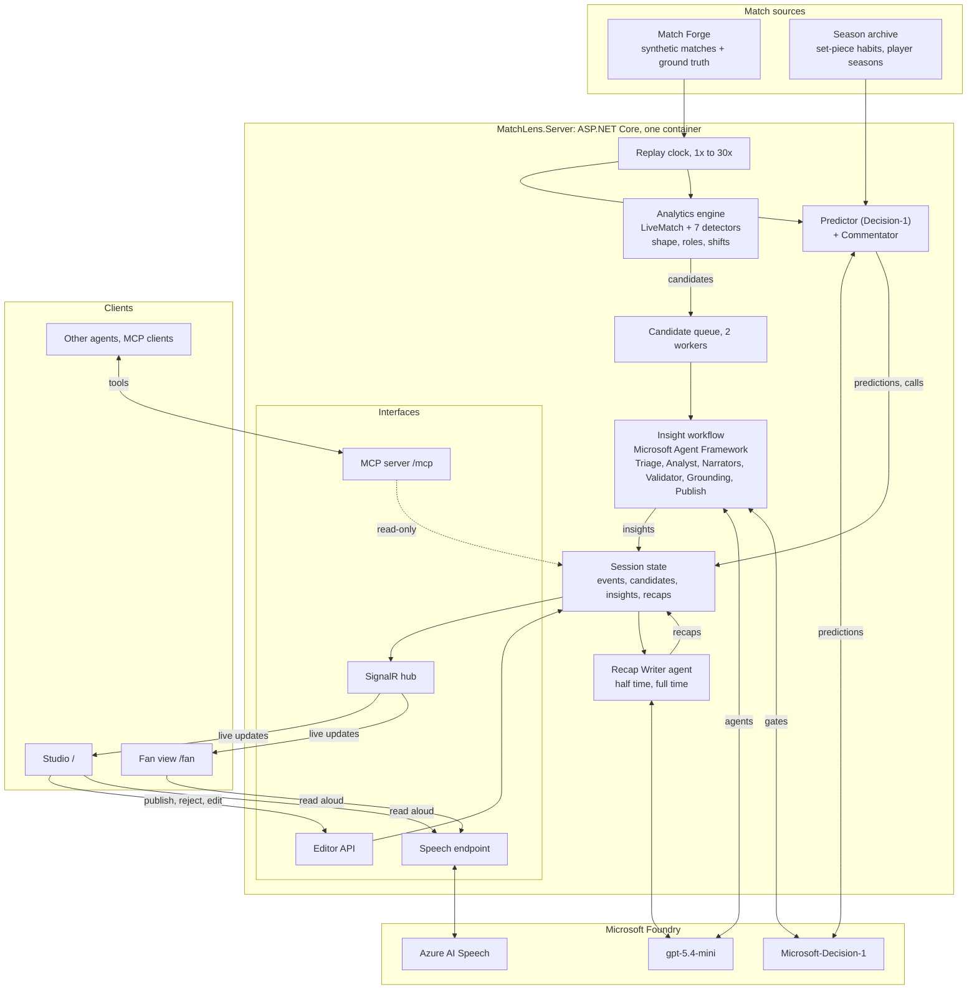
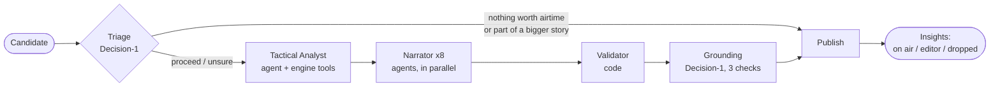
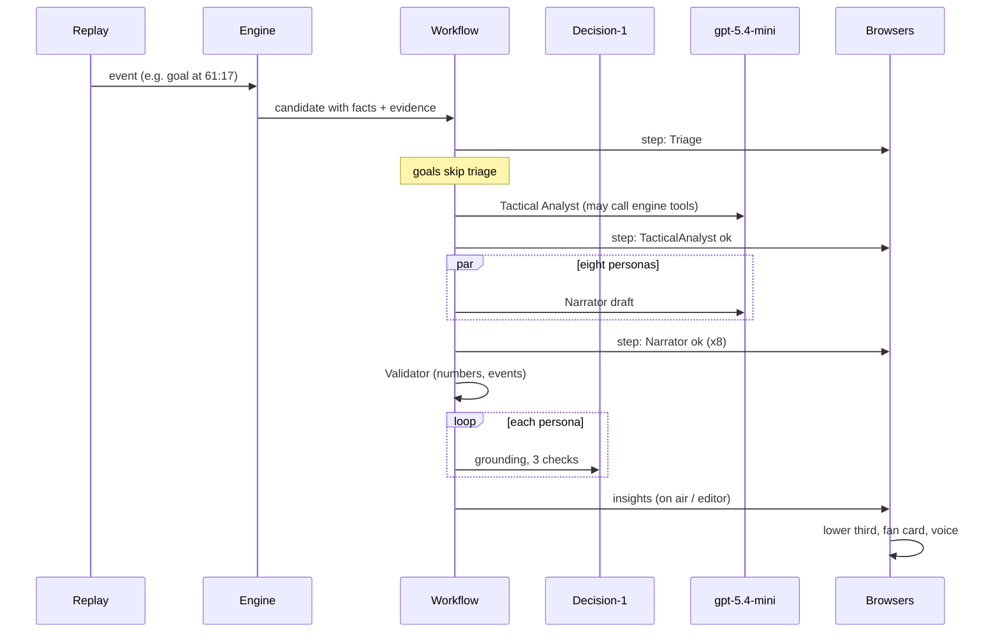

# Second Ball IQ: architecture and features

Second Ball IQ watches a football match as it happens and explains it. A deterministic analytics engine spots the
moments that matter: a press that starts to bite, possession that goes nowhere, a turnover that becomes a chance, a
goal and the move behind it. A team of agents on Microsoft Agent Framework then turns each moment into a short
insight for several kinds of viewer, in English and Finnish. Microsoft-Decision-1 gates what reaches the screen,
and a deterministic Validator checks every number before anything is published. Fans read or listen on their phone,
an editor stays in charge of anything uncertain, and other agents can query the live match over MCP.

Every number a viewer sees was measured by the engine. The language models choose words and which facts to show;
they never supply figures.

A read can also be proved wrong. When a pressing, possession or tactical read goes to air, Second Ball IQ locks a
measurable test for it (a criterion, a deadline and Decision-1's estimate), the watch party votes on whether it will
hold, and the match events settle it: criterion met, not met, or inconclusive. The settled tests are a public record.

## Contents

1. [Who uses it](#who-uses-it)
2. [Main features](#main-features)
3. [System architecture](#system-architecture)
4. [The multi-agent workflow](#the-multi-agent-workflow)
5. [Why the numbers can be trusted](#why-the-numbers-can-be-trusted)
6. [The analytics engine](#the-analytics-engine)
7. [Personas, languages and voices](#personas-languages-and-voices)
8. [Match sources](#match-sources)
9. [Live server, concurrency and interfaces](#live-server-concurrency-and-interfaces)
10. [Data contracts](#data-contracts)
11. [Accuracy and evaluation](#accuracy-and-evaluation)
12. [Microsoft technology used](#microsoft-technology-used)
13. [Running, configuring and deploying](#running-configuring-and-deploying)
14. [Repository layout](#repository-layout)
15. [Limitations and next steps](#limitations-and-next-steps)
16. [Credits and licences](#credits-and-licences)

---

## Who uses it

| User | Where | What they get |
| --- | --- | --- |
| **Fan** | Fan view (`/fan`), on a phone next to the TV or on a desktop | Insights as the match unfolds, written in the style and depth they like (beginner, casual, tactical or commentator) and in English or Finnish, around their club or player; the ball and line-ups on a small pitch; Ask Second Ball IQ, Watch Party with tactical tests to vote on, and Learn the Game; half-time and full-time recaps; everything optionally read aloud |
| **Broadcaster / editor** | Studio (`/`), on a desktop | The live board, the broadcast graphic (lower third) and its on-air preview with the timing contract, the agents' work step by step, and Needs review and the editor queue for anything a gate was unsure about |
| **Other agents and systems** | MCP server (`/mcp`) | The same read-only queries our agents use: window stats, events, player numbers, candidates, insights and recaps |
| **Judges and developers** | Studio Evaluation view, CLIs, docs | Proof against known ground truth, the evaluation runner and the full trace of every decision |

## Main features

**Live understanding of the match**
- Seven detectors find moments worth airtime: pressing shift, possession illusion, turnover to chance, goal,
  player milestone, tactical shift and player role. They run on the event stream as it arrives.
- Every candidate carries measured facts, the event ids it rests on, a neutral summary of the window and derived
  evidence in plain language.

**A multi-agent workflow per moment**
- Triage (Decision-1) decides whether the moment deserves airtime, folds chances into a bigger story when one is
  running, and sends unsure cases to the editor.
- The Tactical Analyst agent explains why the moment matters, using engine tools to look at the wider match.
- Narrator agents write the insight for eight personas in parallel (casual, analyst, broadcast and beginner, in English and Finnish).
- A deterministic Validator checks cited events and every number.
- Grounding (Decision-1) checks that each draft follows from the evidence.
- Publish decides: on air automatically, to the editor, or dropped.
- Every model step falls back to a deterministic template, so a failing model never loses a true moment.

**Live predictions**
- Before every corner, direct free kick and penalty, Decision-1 predicts where the ball goes (near post, central,
  far post or short; the shooter's left, centre or right) from the taker's record over the season so far and this
  match. The replay holds for a moment so the call is on screen before the kick.
- Every 15 minutes, and when a pressing shift or possession illusion is spotted, it calls who scores in the next 10
  minutes from the run of play.
- Each call is settled by what actually happens, and the running track record ("4/6 calls right") is public.

**An excited commentator**
- Instant calls on goals, big chances, set pieces, settled predictions and players on a roll ("That's two for
  Arlo Quinn today!"), in English and Finnish. Built from the event and the engine's counts, never from a model, so
  they are immediate and always right.
- Read in an excited neural voice (en-US-GuyNeural with the `excited` and `shouting` styles; Finnish with faster,
  higher prosody). Calls jump the voice queue and a goal cuts in on whatever is being read.
- A goal takes over the screen for four seconds.

**Tactical intelligence: shape, roles and the coach's plan**
- The engine reads each team's shape from where its players touch the ball: average positions, the formation they
  fit best (4-3-3, 4-2-3-1, 4-4-2, 3-5-2, 3-4-1-2, 3-4-3) and each player's role, including the ones that reveal a
  plan: false nine, second striker, shadow striker, inverted winger, wing-back.
- It notices when a team changes how it plays (a new structure, dropping into a low block, going direct) and links
  the change to what came just before it: a substitution, a goal for or against, half-time. The Tactical Analyst
  agent explains the coach's likely intent, framed as an interpretation.
- On the board: Shape (average positions with roles and formations), Heat map (where a team had the ball), and for
  a tactical shift a before/after view with arrows showing who moved. A Tactics tab adds each team's style in
  numbers (high press, long balls, how deep it defends); every player card has a heat map and the role they are
  playing now.

**Tactical Rewind and player cards**
- Click any moment on the agent desk or on air (or "See how it happened" in the fan view) and the board replays the
  move touch by touch, with a scrubber and before/after numbers for patterns such as a pressing shift.
- Player cards: this match's numbers counted live from the stream, the season so far from the generated archive.

**Pass quality and ball speed**
- Every pass is measured as it arrives: its length in metres and a difficulty rating from 0 to 100. The rating is
  the engine's own rule (`BallMetrics`), not the generator's: length (up to 40 points), a defender pressing the
  passer (20), how far it moves the ball forward (up to 15), the target (15 into the box, 8 into the final third)
  and a lofted long ball (10). Easy under 35, medium 35 to 59, hard from 60. In the demo match easy passes are
  completed 89% of the time, medium 70% and hard 48%, so the rating measures something real; a unit test holds it to that.
- Ball speed for every pass and shot comes with the event (km/h), as a ball-tracking feed would supply it.
- Player identification with indicators: a shot from 110 km/h or a completed pass from 40 m tags the player by name
  on the pitch with the number ("Quinn · 113 km/h", "Moreau · 48 m pass") for a few seconds.
- The commentator calls them: a fast shot ("114 km/h from Hugo Laine! The hardest shot of the match so far!"), a
  goal's speed after the goal, and a long hard pass that arrives ("What a ball from Felix Moreau! 48 metres, and right
  on target."), at most one pass call every six match minutes.
- Where they show: the fan view's Analysis › Passes and speed (completion by difficulty for each team, the hardest
  passes completed and the fastest shots, each replayable on the pitch), the match numbers (pass accuracy, average
  pass length, hard passes completed, hardest shot), player cards, replay captions ("45 m · difficulty 75 (hard) ·
  93 km/h"), Ask (events carry the numbers; `get_top_players` ranks hard passes, longest pass, average pass length
  and fastest shot) and MCP (`get_window_stats`, `get_player_stats`).

**Tracking, running and auto-eventing**
- Match Forge also generates tracking (`TrackingSynth`): all 22 players and the ball ten times a second, in metres
  on a 105 × 68 m pitch, with 12 cm of measurement noise. It is built from the match's events and shape spells:
  players hold their formation slot, shift with the ball and with possession, reach each touch on time and never run
  faster than their own top speed (31 to 35 km/h, keepers 27). Passes and shots fly at the speed the event reports,
  throw-ins go out of play, a change of shape blends over ten seconds and substitutes run on from the touchline.
  A match builds in about 2.5 seconds, in the background when a session starts; until then the session runs without it.
- Running (`Kinematics`) is measured from the noisy frames as they arrive: distance, high-intensity distance (from
  19.8 km/h), sprints (25.2 km/h for at least a second), current and top speed, all on half-second averages so the
  noise does not add distance. Over 20 matches distance is within 1.7% of the noise-free truth. A player is tagged on
  the pitch on passing 33.5 km/h (at most once every two minutes) and at 5 and 10 km, and the commentator calls the
  fastest sprint of the match and the first player to 10 km.
- Auto-eventing (`AutoEventer`) reads only the positions, never the events, and finds passes (receiver, length, ball
  speed, completed or not), shots (speed and result: goal, saved, blocked, off target) and ball wins, the way an
  eventing model over tracking would. Its detections are scored against the event feed live (studio › Evaluation)
  and over many matches with `forge autoevent`. Over 20 matches (5 scenarios × 4 seeds): passes 96.2% found and
  98.4% real, completed-or-not right 99.0%, receiver right 98.8%, length ±1.5 m, ball speed ±2.6 km/h; shots 78.4%
  found and 88.0% real, result right 99.6%, speed ±3.0 km/h, all 12 goals found; ball wins 95.8% found, 87.2% real.
- What this shows and what it does not: the tracking is synthesised from the events, so auto-eventing on it is a
  consistency test of the detector, not evidence on real video. It proves the path from positions to the same
  numbers works end to end, and it fixes the place a real tracking feed, or a vision model's output, plugs in:
  `TrackingFrame` (`src/MatchLens.Contracts/Tracking.cs`).
- Where they show: the players and the ball move on the stage from tracking once it is ready; Analysis › Running,
  passes, speed (furthest and fastest); player cards and match numbers (distance, top speed, sprints); Ask
  (`get_running`); MCP (`get_running`, `get_auto_events`); and the studio's Evaluation card.

**The 3D stage**
- On a wide screen with WebGL the fan view's match stage is 3D (React Three Fiber, `web/src/components/Stage3D.tsx`,
  loaded only then): the far stand and both ends full of supporters in their club's colours (the scoring end jumps on
  a goal), floodlights and a scrolling LED board, and the 22 players in kit with their numbers, moved from the
  tracking frames and smoothed between them, with the ball in the air.
- A broadcast camera follows the ball from the main stand side and cuts to a reverse angle behind the goal on a goal
  or a big chance (the commentator's call), then cuts back. With reduced motion it holds a wide shot.
- The page's own pieces stay ordinary DOM, so they keep the theme and stay crisp: each frame the scene projects a
  point or a plane and moves the element there with a CSS perspective transform. The speed, distance, shot and pass
  tags sit over the player; the pinned card (tactical test, poll or prediction, or the score) hangs on the far stand;
  and a replay, a heat map or a team's shape from the 2D board is drawn on the 3D grass, with its controls below the
  picture. A replay also plays in 3D: the player on the ball and the ball travelling along the move.
- The ground is procedural: regulation markings with corner flags, goals with round posts, back frames and a diamond
  net that ripples on a goal, floodlight masts with beams through the haze (they pulse with the crowd on a goal),
  LED boards along the far touchline and behind each goal (they switch to GOAL), two big screens in the far corners
  (the score and clock, and the commentator's latest call), phone flashes in the crowd (a burst on every shot, the
  whole ground on a goal) and a trail behind the ball (gold for a shot).
- Players are articulated (hips, knees, shoulders, elbows) with a gait whose stride follows the distance covered and
  whose size and forward lean follow the measured speed; they kick on their pass or shot, lunge on a tackle or
  interception, and a keeper sets himself when the ball is near and dives on a saved shot. Numbers on the back and
  above the head. Kits: the clubs' own colours, or a high-contrast or classic set for video.
- Cameras: Auto (the director, with the cuts), Broadcast (follows the ball, no cuts), Tactical (high and wide) and
  Drone (a slow orbit), keys 1 to 4. The follow cameras widen as the ball travels faster, and a goal shakes the
  picture.
- DVR: the last 15 seconds of tracking can be paused, scrubbed and played again (the big screen says REPLAY). The
  telestrator draws from the frame on screen, live or replayed: the offside line as a wall in the defending team's
  colour (second-last defender, the ball or halfway, whichever is the line) with attackers beyond it ringed, each
  team's outfield shape as a hull with its width and depth in metres, arrows ahead of high-intensity runs, pitch
  control on the grass, and a locked player (click him) under a spotlight with his live speed, distance, top speed
  and sprints.
- H hides every control and graphic for a clean feed; F puts the stage full screen.
- Player cam (key 5, or "Watch with the player cam" on the followed player's card): a chase camera a few metres
  behind and above the fan's player, turning smoothly with his direction of play. The card beside it shows his
  distance, top speed, speed now and sprints, live from tracking.
- The Room uses the 3D stage too, with the watch party's stand as a slim band across the top. The 2D stage stays on
  phones, when WebGL is missing or fails, and whenever the fan switches to it (the choice is remembered).

**Spatial analytics from tracking**
- Expected threat (xT): a 16 × 12 grid of how likely a team is to score within its next few actions from each part of
  the pitch, solved by the standard value iteration over shots, xG and where completed passes take the ball. It is
  fitted on our own simulated matches (`forge xt`: 100 matches, written to `XtGrid.cs`), not borrowed from published
  real-football values; with a real feed the same fit runs on a season. It rises from 0.01 in a team's own half to
  0.09 in the six-yard box.
- Pitch control: for every spot, which team would get there first. A time-to-intercept model (after Spearman, and
  Fernández and Bornn): each player carries on his way for 0.7 s, then runs straight at 7.8 m/s; the control is a
  logistic of the difference between the two teams' quickest arrivals (σ = 0.45 s). A 32 × 21 map every match second
  (`PitchControl`), sent to the browsers once a second.
- Pass difficulty with the passing lane: at the moment each pass is played, the opponents who could reach its path
  before the ball (a lofted ball only near its ends) and whether the target is marked join the event-only rating's
  ingredients (`PassLanes`). It is still checked against how often passes are actually completed, on 20 matches the
  fit never saw (`forge spatial`): easy passes are completed 87% of the time, medium 64% and hard 41% (54% for hard
  with the event-only rating), and the rating predicts a failed pass better (AUC 0.705 against 0.680). With no
  opponent able to cut a pass out, 86% arrive; with one, 73%; with two or more, 64%.
- Better pass available: at the moment of each pass, every teammate the passer could have found (not in an offside
  position) is valued as the chance the pass arrives (a logistic of the lane difficulty fitted on 19,700 simulated
  passes) times the xT where it would arrive. A better option must add at least 0.02 xT and arrive at least 55% of
  the time: 1.8% of passes miss one, by 0.03 xT on average.
- Pitch control means chances: in the quarter of five-minute spells with the most final-third control, teams averaged
  0.77 shots, in the quarter with the least 0.26 (Spearman ρ = 0.25 over 720 spells).
- Two detectors on top, whose candidates go through the same agents, gates and Validator as the event detectors'
  (`SpatialMonitor`): **Territory** (a team controls at least 34% of the final third over five minutes, 8 points up
  on the ten minutes before; about once a match) and **Better pass** (a player misses a better-placed teammate three
  times in ten minutes, 0.06 xT or more in all; about once a match). A territory read goes to air with a tactical test
  (the team keeps at least the midpoint of its old and new control until the deadline), measured from tracking and
  settled in code like the others, and becomes a watch-party poll.
- Where they show: Analysis › Space and threat (the live pitch-control map, the xT map, each team's hold on its final
  third, the better passes missed, each replayable with the missed option drawn as a gold arrow, and difficulty with
  the lane against completion); the Space layer on the 3D grass; replay captions ("with the lane 79 · 1 could cut it
  out · better: Quinn +0.04 xT"); Ask and MCP (`get_space`).
- Honest limit: on synthetic tracking, players are placed to match what the events say happened. Interceptors now
  react only half a second before a pass is played, so the lane check does not simply read the outcome, but the
  speed limiter still lets a defender start a little early; on real tracking this check would be clean.

**Broadcast overlay**
- `/overlay` is the live graphics on their own, 1920 × 1080, for a vision mixer or OBS to key over the match picture:
  transparent by default (`?mode=alpha`), green or blue for a chroma key (`?mode=key`, `?mode=blue`), or a dark pitch
  to judge by eye (`?mode=preview`).
- On it: the score bug; the agents' checked insight as a lower third for the display time it carries (with the
  Decision-1 grounding and two of its measured figures); the commentator's call on a goal or a big chance; a goal
  splash; a player's speed or distance tag from tracking; a tactical test as it locks (with Decision-1's estimate)
  and when the match settles it; the coach's corner when Decision-1 picks (both coaches' plans with its probability
  for each, the pick marked) and again when the match has settled both (which plan held, and whether the pick was
  it). Tests and the coach's corner share one slot bottom right and take turns in arrival order (a card that would
  wait over 30 s is dropped); a goal clears that slot and the player tag while it plays. `?persona=Broadcast-fi`
  switches style and language.
- SMPTE timecode (time of day, 25 fps, non-drop) in the corner (`?tc=0` hides it), and machine-readable render
  metadata: a JSON block (`#render-metadata`), `window.__overlay` and a `postMessage` to the parent frame on every
  change, saying what is on screen, since which timecode, and where each graphic came from (insight and candidate
  ids, evidence events, grounding, test estimate).

**Recaps**
- At half time and full time the Recap Writer agent tells the story of the match for every persona, using only
  what already went to air, the measured stats and the score. Its numbers are checked like the Narrator's.

**Editor in the loop**
- Insights a gate was unsure about wait in the editor queue with the reason. The editor publishes, rejects or
  edits; an edit goes through the same Validator, so an editor cannot put an unmeasured number on air either.

**Ask Second Ball IQ**
- Fans ask anything about the match in plain language (English or Finnish), in the fan view's Ask tab or the
  studio. Suggested questions come from what the engine just found ("Why did Northvale switch to a 3-4-1-2?").
- A Match Analyst agent (Microsoft Agent Framework) investigates with thirteen read-only tools over the match frozen at
  the second of the question: match state, window stats, compare two spells, describe a window, find events, event
  details, player stats, team shape, published moments, predictions, players' running, space and missed passes, and a player ranking for any stat.
- Every answer is checked before it is shown: every number must appear in a tool result from this conversation,
  cited events must exist and not be in the future, actions must point at real teams, players and minutes; a
  failed check gets one retry, then the fan sees only measured facts. Decision-1 grounding then checks that the
  answer follows from the tool results ("Checked by Decision-1").
- Answers say whether they are measured, an interpretation, or beyond the data (shape and roles come from touches; running
  comes from tracking), and carry evidence to open on a small pitch: replay the events, compare a team's shape in two
  spells, a heat map, or a player card. Follow-up questions keep the conversation's context. Answers can be read
  aloud, questions can be asked by voice (the browser's speech recognition, English or Finnish), and the same agent is
  an MCP tool, `ask_matchlens`. `pipeline demo-match --ask --at 70` runs a fixed question set (including an off-topic
  one) against the live models and reports how many were answered, checked by Decision-1, or fell back.

**Tactical tests: make a read, lock the test, let the match decide**
- When a pressing shift, a possession illusion or a tactical shift goes to air (automatically or by the editor), a
  test is locked for it at that match second. The definition, the event rule and the deadline are fixed then and
  never change; only the progress and the result do.

  | Read | Criterion (window) | Settles |
  | --- | --- | --- |
  | Pressing shift | At least 2 distinct shots straight after the team's high regains (10 min) | Met as soon as the second shot comes; not met at the deadline |
  | Possession illusion | At least 55% of the passes and no more than 0.30 xG (10 min) | Not met as soon as xG passes 0.30; otherwise at the deadline |
  | New formation | The team's positions fit the new formation better than the old one (15 min) | At the deadline; inconclusive if too few players had enough touches to read a shape |
  | Sitting deeper | High-press rate at or below halfway between the old and the new level (10 min) | At the deadline |
  | Going direct | Long-ball share at or above halfway between the old and the new level (10 min) | At the deadline |

- Decision-1 gives an estimate that the criterion will be met, from a plain description of the ten minutes before the
  lock. It is asked after the lock from the match as it stood at the lock, so it cannot see later events; it has 3
  seconds, and without an answer the test has no estimate. Everywhere it appears it is labelled a model estimate,
  not a calibrated probability.
- The result is what the events show, not proof of the read: a met pressing test shows the press kept producing
  shots, not that the press alone caused them. Each test says what it cannot show. Inconclusive is a real outcome: a
  window cut short by full time (under 6 minutes played) or a shape that could not be read. No test opens after
  84:00, when too little of a window is left.
- The record (studio "Tactical tests", fan Analysis view, MCP `get_tactical_tests`) counts met, not met,
  inconclusive and open, and how often Decision-1's estimate was on the right side of 50%. With a handful of tests
  per match that is a count, not a calibration.
- **Coach's corner** (`CoachCorner`, `CoachPlans`): two coach agents (Microsoft Agent Framework, structured output)
  with opposite instincts, the front-foot coach and the game manager, each pick one plan for a team from a menu and
  give one sentence why; the second must choose a different plan. The menu sets each target from the ten minutes
  before, so it asks for a real change the team can reach: press higher (high regains, one more than in the last ten
  minutes, at least 2), sit deeper (opponent xG at most 0.25), go direct (long-ball share 8 points above the team's
  own), keep the ball (55% possession), take the final third (pitch control 5 points above now; only with tracking).
  A rationale with a number the brief does not carry is replaced by a plain one. Without models the coaches fall
  back to plain rules (the front-foot coach pushes; the game manager protects when ahead and controls otherwise).
- Decision-1 then picks between the two as a choice question, one option per coach, each described by the
  criterion that settles it, from the same plain brief the coaches read (score, the last ten minutes for both teams,
  and final-third control from tracking). It returns the pick and a probability for each; 6 s timeout, and without an
  answer there is no pick but both plans are still tested. Both plans are locked as tactical tests at once
  (Decision-1's probability as each test's estimate). Once both settle, the decision gets a verdict: right (the pick
  held and the other did not), wrong (the other way round) or level. It runs every fifteen minutes for each team, from
  the first quarter-hour mark at least two minutes in, and on demand (`POST /api/coach/{teamId}`); a new decision for
  a team waits until its last one is settled. Studio "Coach's corner", fan Analysis › Coach's corner, MCP
  `get_coach_corner`.
- **What-if sandbox** (`WhatIf`, `POST /api/whatif`): take the tracking frame on screen, move one team's outfield
  players (push up or drop deep by 1 to 20 m, widen or narrow around their centre, or send the three nearest players
  towards the ball) and compute pitch control again. It reports the team's share of the whole pitch, the final third
  it attacks and the third it defends, before and after, and asks Decision-1 (yes/no) whether the change would help
  over the next ten minutes, from the brief plus the measured change. It is a still picture: everyone else stays
  where they were, players keep their velocities, so it shows how the space changes, not what would happen next.
- Player roles are not tested: ten or fifteen minutes rarely give a player the 12 touches a role read needs, so
  almost every role test would end inconclusive (50 of 54 in 24 simulated matches).
- Over 60 simulated matches (5 scenarios × 12 seeds), 134 tests opened: possession 38 met / 10 not met, pressing
  17 / 21, formation 23 / 2, sitting deeper 9 / 3, going direct 6 / 5. In the demo match the possession read at
  41:13 is broken by Harbor City's goal and shots (not met at 46:45), the pressing read at 53:00 is met at 59:53,
  and Northvale's 3-4-1-2 is confirmed at 72:01.

**Second Ball IQ Watch Party**
- Friends watch together in a room with a 4-letter code and an invite link (`/fan?party=CODE`). The room is built
  around what Second Ball IQ finds, with a short screened chat alongside.
- The room is the stand: the same match stage as Live (the stand over a pitch in perspective, with the ball, the
  replays), with the room's members in the front row of their club's end, names under them
  (simulated fans in italics). When a tactical test is open, wristbands light across the stand in the room's split
  (members show their own vote); when the match settles it, the fans who called it pulse. A goal makes the scoring
  end jump with arms up.
- At the top of the room's panel, its pulse: **the room against Second Ball IQ**, a running score of every settled
  pick (the room's majority pick against Second Ball IQ's) and every settled tactical test (the room's majority vote
  against which side of 50% Decision-1's estimate was); an energy meter that rises with reactions, messages and what
  happens on the pitch (a goal most of all) and dies away when it is quiet, from Quiet to Bedlam; and the members with
  their points, their reactions popping over them. A goal sets off a burst over the room in the scorer's colour.
  Open polls count down on a ring, and a settled test's poll is stamped HELD or BROKEN.
- The right-hand panel has the room: the pinned poll or pick (closeable; a new one, or its result, pops up again),
  the tifo controls, and one feed of everything in the order it arrives (match moments, test results, picks, shared
  answers and fans' messages) with All / Match / Chat filters and a message box at the top. Room questions and the
  leaderboard fold away under it.
- Fan chat: messages of 1 to 160 characters, one every 3 seconds per member, screened by a word list and then a
  Decision-1 check that the message is respectful (accepted when Decision-1 is unavailable or slow, after 3 s, so
  chat never stalls). The room keeps the last 60 messages; they are rendered as plain text. Simulated fans in demo
  rooms post short lines after goals, big chances and settled tests.
- Digital tifos: anyone who supports a club can start one for their end (stripes, a shirt, a star or the club's short
  name, all drawn from the kit). For 12 seconds that end raises cards, and the mosaic builds over the stand as cards go
  up; then it is revealed across the stand for 10 seconds, on every screen at the same moment. One tifo at a time per
  room, at most one every 40 seconds. In demo rooms the scoring side's simulated fans raise one after a goal.
  The mosaic is drawn over that club's half of the stand.
- Reactions (🔥 😱 👏 🤔) float across everyone's screen.
- Tactical-test polls: when a test locks, the room is asked "Will it hold?" with the locked criterion and deadline.
  Votes lock after 40 seconds ("the match decides by 63:00"); when the match settles the test, the room sees the
  result, how it voted and Decision-1's estimate, and the stand's wristbands show it. The room's votes are
  stored apart from the result. In demo rooms a met test raises that side's tifo.
- Room polls open when Second Ball IQ publishes a read that is not tested (for example, a second read of something
  already being tested): after 40 seconds Second Ball IQ gives its own verdict with the measured numbers and how many in
  the room agreed.
- Crowd picks: before each set piece (and for "next goal") the room picks too; the result shows the room's pick,
  Second Ball IQ's pick and what happened.
- Points (optional; the room works the same without looking at them), all settled by code and shown in the room:
  - **Picks**: settled by the event itself (where the corner went, who scored next). A right pick earns 3 points,
    or 5 when Second Ball IQ's own pick was wrong; a wrong pick earns nothing.
  - **Tactical tests**: settled by the events at the deadline (or earlier, when a count is reached). A right call
    earns 2 points; an inconclusive test earns nothing.
  - **Polls**: Second Ball IQ's verdict is fixed from the measured numbers when the poll opens (for example, "yes, they
    have taken control" when the high regains doubled). A vote that matches it earns 1 point when the poll closes.
  - A live leaderboard shows the top five; simulated fans are labelled.
- Room questions: anyone posts a question, others upvote it; the most upvoted goes to Ask Second Ball IQ and the answer
  appears for everyone. Questions are screened in layers, none of them the only line of defence: 5 to 200
  characters, a word list, rate limits (one question per member every 15 seconds, at most 3 open per member and 12
  per room), then a Decision-1 check that it is a respectful question about the match (skipped, not trusted
  blindly, when Decision-1 is unavailable). Everything members type is rendered as plain text, never as HTML.
  Reactions are limited to four emoji and one every 0.4 s per member; shares carry at most 20 well-formed event ids,
  one every 5 s. The host can send a question straight away. Ask Second Ball IQ
  answers can be shared with the room ("Show everyone"), and open as a replay on each screen.
- Demo rooms add eight simulated fans, labelled as simulated everywhere, who react, vote, pick and ask, so one
  presenter can show a lively room.
- Rooms are SignalR groups in the same server; the party service listens to what the match broadcasts. In memory, one
  match at a time.

**Follow the match your way** (fan view)
- A 15-second first-run setup, changeable any time: how well you know football (new, casual, tactics fan), what
  you care about (whole match, my club, my player), how you follow (read, listen, ask) and whether you watch alone
  or in a watch party.
- Explain level is independent of the level: Quick (commentator wording), Explain (simple, or the Beginner
  narration with Learn the Game on) and Tactical (analyst wording).
- My club: the feed keeps your club's moments and every goal; only your club's commentator calls are spoken.
  My player: a live spotlight (numbers, role, heat map), a badge on every moment they are in, and an alert for each
  shot, goal or high regain.
- Learn the Game: a hand-written bilingual glossary of 23 concepts with small diagrams. Every card gets chips for
  the concepts it touches ("What's a high press?"), mapped deterministically from the moment's kind and the
  engine's tags, with "See it in this match" opening the replay. A Learn tab marks the concepts already seen.

**Fan experience**
- Fan companion for phone and desktop (Fluent UI): a match header with both kits and the scorers, and under it an
  LED ticker of commentator calls and tests that can be hidden from the header; one match stage that is always on
  screen (the stand of fans over a pitch drawn in perspective) and a panel beside it (under it on a phone) for the
  section. Five sections on a bottom bar: Live, Room, Analysis (tabs: formations and heat maps on a flat pitch in
  the panel, so the live pitch stays in view; possession with the match numbers and a minute-by-minute strip;
  tactical tests and set pieces), Players (the player's heat map and the line-ups on the stage, the card in the
  panel) and Ask (answers' visuals play on the stage). Replays, deciding events and shared answers take over the
  stage's pitch, labelled above it (never over it) with a "Back to the match" button. The newest poll, test or
  set-piece call is pinned at the top of the panel.
- Read aloud with Azure AI Speech neural voices, a different voice per style and language, falling back to the
  browser's own voice if Speech is unavailable.

**Broadcast experience**
- Desktop studio (Fluent UI) with a green match board (passes, shots sized by xG, high regains, cited evidence
  ringed, the player on the ball as a numbered shirt), a minute-by-minute possession strip, the lower-third graphic,
  an on-air preview with its countdown and timing contract, a Needs review panel, and the viewer and "Voice"
  controls for the output.
- The agent desk shows each moment's six workflow steps lighting up live, with the analyst's reading, every step's
  result and the texts the gates read.

**Openness and proof**
- MCP server exposing the engine and the results to any MCP client.
- Ground truth for every generated match; the studio's Evaluation view and `forge evaluate` score the detectors against it.
- All data is synthetic: fictional clubs and players, generated matches and a generated season history.

---

## System architecture



**How a match flows through it**

1. Match Forge provides the event stream and a generated season behind it (the takers' set-piece history and every
   player's season numbers).
2. The replay clock feeds events to the analytics engine at the chosen speed and streams them to the browsers.
3. When a detector fires, the candidate goes into a queue. Two workers take candidates from it, so a slow
   narration never holds up the clock or a goal.
4. Each candidate runs through the multi-agent workflow against a frozen copy of the match as it stood at that
   moment.
5. Insights are stored and pushed over SignalR: straight to air, or to the editor queue.
6. Before a set piece the Predictor asks Decision-1 where the ball goes and the replay waits for the answer; the
   Commentator turns events and settled predictions into live calls.
7. At half time and full time the Recap Writer turns the published insights into recaps.
8. Browsers can ask for any insight or recap read aloud; MCP clients can query everything.

Everything runs in one process and one container. State lives in memory for the length of a session, which keeps
the demo simple and the cost near zero.

---

## The multi-agent workflow

Each candidate runs through one workflow built with `WorkflowBuilder` from Microsoft Agent Framework
(`Microsoft.Agents.AI.Workflows`). Each step is an executor; a shared `InsightWork` object carries every result
and a trace step from one executor to the next, and each step is streamed to the studio as it finishes.



| Step | Kind | What it does | If it fails or is unsure |
| --- | --- | --- | --- |
| **Triage** | Decision-1, choice question | Reads the neutral window summary and picks which development deserves airtime. A confident "none" drops the candidate. A confident different story folds a chance into that story (a chance inside a pressing spell, which has its own insight). Goals always proceed, and so do reads measured over minutes (shape, roles, better passes, territory), which its window summary does not describe. | Low confidence or a timeout sends the moment to the editor, unless triage names this moment's own kind at 0.55 or more with a 0.20 margin |
| **Tactical Analyst** | Agent (`ChatClientAgent`, gpt-5.4-mini) with tools | Explains in one or two sentences why the moment matters, picks the 2 to 4 facts that show it and the events to cite. Can call `get_window_stats`, `describe_window`, `get_events` and `get_player_stats` on the live engine. Unknown players, distant events and non-existent facts are removed from its output. | Template analysis |
| **Narrator** | Agent, one call per persona in parallel | Writes a headline (at most 60 characters) and a one-to-two sentence summary for the persona's audience and language, and picks up to three fact keys to show as figures. | Template draft |
| **Validator** | Deterministic code | Every cited event exists and belongs to the moment; every number in the text is a measured fact (also as a percentage or rounded), the score, the window length or a minute of the moment; no he or she (the players are fictional and their gender is in no evidence). | A failing model draft is replaced by the template |
| **Grounding** | Decision-1, three yes/no checks | Do the events the claim describes appear in the evidence? Are outcomes (goal, save, miss) described as in the evidence? Would a neutral analyst agree with the overall point? Reads measured over minutes, and milestones counted over the match, describe a pattern, not events, and get the last two checks only. | A rejected model draft is replaced by the template and grounded again; unsure or timeout goes to the editor |
| **Publish** | Code | Builds Insight v1 records. **Auto** when every gate passed, **Editor** when any gate was unsure, **Drop** when validation failed or grounding rejected a model draft. A template is never dropped: it is built from verified facts, so a true moment (a goal above all) cannot vanish on a model's doubt. | |

**Decision-1 thresholds** (from the spike, see `docs/decision-1-spike.md`): triage proceeds when the top option has
at least 0.70 and a margin of at least 0.20; grounding passes when every check is at least 0.40 and drops when any
check is at most 0.15, with a 2.5 s timeout. Requests time out after 4 s and are retried once.

**Tuned on the first full live run** (Oct 26, demo match from 38′ at 8×, gpt-5.4-mini and Decision-1; 207 Decision-1
calls, median 161 ms, slowest 612 ms; 180 chat calls, median 1.3 s, slowest 6.7 s; no timeouts). Of 16 moments only
5 went to air for most personas; the rest waited for an editor. Three causes, three fixes: the "every event listed"
check scored 0.00 to 0.15 on true formation, role and better-pass reads (their claims describe a pattern), so those
reads are grounded on outcomes and fair reading only; triage held a turnover-to-chance at 0.67 although it named
that very kind with a 0.48 margin, so agreeing triage now proceeds from 0.55; and the territory read was always
dropped because the Validator rounded 0.285 × 100 (28.499… in binary) to 28 while the text said 29%, now fixed.

**The Recap Writer** is a separate agent outside the per-moment workflow. At half time (after first-half moments
finish, at most a minute later) and at full time it writes, for every persona, a headline, two or three paragraphs
and the 2 to 5 key moments by insight id. It sees only the published insights with their facts, each team's
measured stats and the score.



---

## Why the numbers can be trusted

Second Ball IQ is built in layers so that no model can put a false number in front of a viewer:

1. **The engine measures, models do not.** Facts come from deterministic code over the event stream.
2. **The analyst cannot add numbers.** It returns fact *keys*, event ids and words; anything it cannot back up is
   removed.
3. **The Narrator never writes figure values.** It chooses fact keys and code copies the values.
4. **The Validator checks every number in the text** against the measured facts and the score, and every cited
   event against the moment. A failing draft is replaced by a template built only from facts.
5. **Grounding checks meaning.** Decision-1 checks that the claim follows from the evidence: right events, right
   outcomes, a fair reading.
6. **People decide when the gates are unsure.** The editor sees the reason. An edit is validated like a draft.
7. **Recaps follow the same rule.** The Recap Writer sees only published moments and measured stats, and its
   numbers are checked the same way.

Prompts also tell every writer not to invent players, records or history, to keep names exactly as given, and to
refer to (fictional) players by name rather than "he" or "she".

---

## The analytics engine

`MatchLens.Analytics` is plain, deterministic C#. `LiveMatch.Ingest(event)` takes events in order, rejects
duplicates and clocks that go backwards, and returns any candidates. Event detectors run on every event; window
detectors run once per 60 seconds of match time.

| Detector | Fires when |
| --- | --- |
| **Pressing shift** | In the last 8 minutes a team won the ball in the opponent's defensive third at least 5 times, at least 3 more than in the 8 minutes before, and at least one of those recoveries led to a shot (10 min cooldown per team) |
| **Possession illusion** | In the last 10 minutes a team had at least 72% of completed passes (at least 45), at most 1 shot and at most 0.15 xG (15 min cooldown) |
| **Turnover to chance** | A shot of at least 0.08 xG, or any goal, within 15 s of the same team's high recovery with no opponent possession in between |
| **Goal** | Any other goal, with the move behind it: passes and seconds from winning the ball to the shot, and who made the final pass |
| **Player milestone** | The match's leading passer completes pass 50, 75 or 100 |
| **Tactical shift: formation** | Every 3 minutes the last 15 minutes of average positions are matched to formation templates (optimal assignment after standardising both). A new formation must fit better than the established one by a margin, in two checks running |
| **Tactical shift: low block** | Over the last 15 minutes, the share of the opponent's own-half passes the team pressed, and its share of all opponent passes, both fell clearly below the match so far (two-proportion z of at least 2.2 and 2.8) |
| **Tactical shift: direct** | The share of long balls rose clearly above the match so far (z of at least 3) to at least 25% |
| **Player role** | Over the last 25 minutes a player with at least 20 touches plays a distinctive role (false nine, second or shadow striker, inverted winger, wing-back), confirmed in two checks; once per player and role, at most one new role per team every 6 minutes |

Shape detection was tuned in the Python prototype on 30 seeds per shape: the right formation 97-98% of the time from
30-minute windows; a formation change found in 29 of 30 matches about 13 minutes after it, with 0.1 false alarms per
match; going direct found in about 75%, a low block in about 60% (the weakest signal: few pressures per window).

Each candidate carries **facts** (measured numbers), **evidence event ids**, a **window summary** (neutral prose
about both teams, the same whichever detector fired, for triage) and **evidence** (derived facts in plain language
for grounding and the agents). The prose formats came out of the Decision-1 spike: prose beat raw numbers for
triage, and grounding only worked once evidence stated derived facts.

---

## Personas, languages and voices

Each moment is written eight times, in parallel: four styles (Simple, Tactical, Commentator, Beginner), two languages. The facts and the numbers are the same
in all eight; only the wording changes.

| Style | Written for | Example (the 61' equaliser) | English voice | Finnish voice |
| --- | --- | --- | --- | --- |
| **Simple** (Selkeä) | A casual fan: what happened, in plain words | "Hugo Laine wins it high, Northvale need just 1 pass, and Arlo Quinn scores 4 seconds later." | en-US-AndrewNeural | fi-FI-NooraNeural |
| **Tactical** (Taktinen) | Someone who wants the why: pressing, xG, the mechanism | "A sharp high-press turnover into a 0.159 xG goal leaves Harbor City unable to recover shape." | en-GB-SoniaNeural | fi-FI-SelmaNeural |
| **Commentator** (Selostaja) | A TV graphic or a commentator's line | "Northvale punish the turnover fast." | en-US-GuyNeural, excited style | fi-FI-HarriNeural, faster and higher |
| **Beginner** (Aloittelija) | Someone new to football: everyday words, terms explained, and why the moment matters | "Northvale won the ball near Harbor City's goal and scored 4 seconds later. Attacking straight after winning the ball catches the other team out of position." | en-US-AvaNeural, slightly slower | fi-FI-NooraNeural, slightly slower |

Live commentator calls use the excited voice in both languages, with the `shouting` style for goals.

A persona can also carry a favourite club and a focus player; the fan view uses the favourite club to filter and
mark that side's moments, and Ask Second Ball IQ frames its answers from that side.

**Three words that are easy to mix up**

| Term | Who chooses | Values | What it does |
| --- | --- | --- | --- |
| **Narration style** (`Audience` in code) | Nobody: every moment is written in all of them | Simple (`casual`), Tactical (`analyst`), Commentator (`broadcast`), Beginner (`beginner`), each in English and Finnish | The 8 personas the Narrator, Recap Writer and voices write for |
| **Explain depth** | The fan, in the fan view's settings | Quick, Explain, Tactical (plus Learn the Game on or off) | Picks which narration the fan reads: Quick → Commentator, Explain → Simple (Beginner when Learn the Game is on), Tactical → Tactical. Their level (new, casual, tactics fan) only sets the starting depth |
| **On-air viewer** | The broadcaster, in the studio's on-air preview | Any of the 8 personas | Which narration goes to the lower third and is read aloud in the studio |

So "broadcast" is a writing style (short, commentator-like), not the broadcaster: the studio can put any of the
eight on air.

---

## Match sources

**Match Forge** (`src/MatchLens.Forge`) generates football-realistic matches as an event stream with a
possession-chain simulator: pressing, tackles, passes whose completion depends on accuracy, zone, pressure and
length, and shots with expected goals from distance. Scenarios change team styles for phases of the match and inject
scripted moments, so the demo's story always happens; the same scenario and seed always give the same match. Every
match comes with **ground truth**: what the scenario was built to contain, measured from the generated events.

| Scenario | What happens |
| --- | --- |
| `demo-match` | Harbor City's sterile possession, a home goal at 41', Northvale's press after the break, and a turnover goal at 61' for 1-1. Tactically: Harbor's false nine and inverted wingers, Harbor dropping deep once ahead (43'-61'), and Northvale's switch to a back three with wing-backs, a shadow striker and Elias Varga as second striker at 52' |
| `possession-illusion` | Home dominates the ball 15'-40' against a deep block but creates almost nothing |
| `pressing-shift` | Away presses high after half-time, with scripted high turnovers |
| `balanced` | An even match with nothing scripted; the baseline for false alarms |
| `game-state` | Harbor City score at 28' and drop into a deep 4-5-1; at 40' Northvale bring on a second striker, switch to 4-4-2 and go direct |

**Shapes, roles and coaches.** Each club has a formation of eleven role slots (a home position on the pitch for
every player). The simulator gives the ball to whoever's position is nearest where it is, and passes drift towards
the receiver, so touches gather around each player's role and the engine can read the role back. Scenarios can
script coaching changes (a new formation, a substitution, a different style) and reactions to the score: a leading
team can drop into a low block, a trailing one can go direct, and they switch back when the score changes. The
ground truth records every shape spell, so the evaluation checks formation changes, low blocks, long-ball spells and
distinctive roles too. Shapes change who plays where and how, never the sequence of random draws for the chances,
so the existing scenarios keep their story.

**Set pieces and the season archive.** Match Forge also generates corners (after saved or blocked shots), direct
free kicks and penalties, each taken by the club's designated taker. Takers have consistent habits (Aino Lehto
favours the near post; Arlo Quinn goes to his right from the spot), and the same habits generate the season archive
(`SeasonArchive`, rounds 1-24 before the match): every set piece those takers hit and every player's season numbers.
So a taker's history really does say something about the next kick, and the predictions have something honest to
learn from. The `demo-match` scenario adds a Harbor City free kick at 66' and a Northvale penalty at 79'.

---

## Live server, concurrency and interfaces

`MatchLens.Server` is one ASP.NET Core process that serves the API, the SignalR hub, the MCP server and the built
web front end.

- **Replay**: events go to the engine at the chosen speed. A start minute replays earlier events instantly,
  without agents.
- **Frozen copies**: each candidate is processed against a private copy of the match as it stood when the
  candidate was raised, so the agents' tools never race the replay and cannot see the future. MCP calls read a
  fresh copy the same way.
- **Two workers** process candidates at the same time.
- **Live trace**: every workflow step is pushed to the browser as it finishes.

**Nothing on the event path waits for a model.** Events are ingested, measured and broadcast by the replay loop;
detectors only queue candidates, and the agents, gates, recaps and Ask run on their own tasks with bounded time:

| Model call | Time limit | If it is slow or fails |
| --- | --- | --- |
| Triage, grounding (Decision-1) | 4 s, one retry; grounding 2.5 s | The moment goes to the editor, never lost |
| Tactical Analyst, Narrator | 30 s each | Template analysis or draft |
| Recap Writer | 45 s | Recap from the published headlines |
| Set-piece and next-goal prediction (Decision-1) | 3 s | Odds from the taker's history, labelled as such |
| Tactical test estimate (Decision-1) | 3 s | The test runs without an estimate |
| Coach agents | 25 s each | Plain-rule coach |
| Coach's corner pick, what-if (Decision-1) | 6 s | No pick (both plans still tested); no estimate |
| Ask Second Ball IQ | 30 s, one retry on a failed check | Measured facts only |
| Watch Party question screen | 3 s | Word list and limits only |

The one deliberate pause is presentational: in a replay a set piece can wait at most 4 s for its prediction and
then hold 2.5 s so viewers can read it, like the pause before a real corner. It does not move the match clock, and
it is a setting (`presentationHolds` on the start request, "Presentation pause before set pieces" in the studio).
With it off, nothing waits: a prediction not ready by the kick is dropped rather than shown late. A live data feed
would run with it off.

**SignalR hub** `/hubs/match` sends `session`, `tick`, `events`, `candidate`, `step`, `insight`, `groundTruth`,
`recap` and `test`; a browser calls `Snapshot()` on connect and reconnect.

Tactical tests are opened by the worker that published the read (or by an editor's approval) and are measured and
settled on the replay thread against the live match after each batch of events, and once more at full time.

**HTTP API**

| Method | Path | What it does |
| --- | --- | --- |
| GET | `/api/health` | Live or offline, models, whether Speech is configured |
| GET | `/api/scenarios` | Generated scenarios and real matches |
| GET / POST | `/api/session` | Snapshot of the current match / start a match |
| POST | `/api/session/plant` | Fault drill: `{kind: "number" or "claim"}` arms a planted error for the next moment |
| POST | `/api/judge` | Judge mode: start the demo match at 38′ at 8×, or join it if it is already playing before 80′ |
| POST | `/api/session/pause`, `/resume`, `/stop`, `/speed` | Match controls |
| GET | `/api/insights?status=` | Insights by status |
| POST | `/api/editor/{id}/approve`, `/reject` | Editor decisions |
| PUT | `/api/editor/{id}` | Edit and publish; 422 with the Validator's problems if it fails |
| GET | `/api/speech/insight/{id}`, `/api/speech/recap/{id}` | The text read aloud (MP3) |
| GET | `/api/speech/call/{id}?lang=en\|fi` | A commentator call in the excited voice (MP3) |
| GET | `/api/players/{id}/season` | A player's generated season so far |
| POST | `/api/ask` | Ask Second Ball IQ: question, style, language, club, player, recent turns; one per viewer every 5 s, 400 per match |
| GET | `/api/speech/ask/{askId}` | An answer read aloud |
| GET | `/api/shape/{teamId}?from=&to=` | A team's shape over any window played so far (seconds): formation, positions, roles, style |

**Three sets of tools.** The engine's queries are exposed in three places, each with the set that interface needs.
All are read-only and run on a frozen copy of the match.

| Tool set | Used by | Tools |
| --- | --- | --- |
| Tactical Analyst tools | Internal: the insight workflow's analyst agent | `get_window_stats`, `describe_window`, `get_events`, `get_player_stats`, `get_team_shape` |
| Ask Second Ball IQ tools (13) | Internal: the Match Analyst agent behind Ask Second Ball IQ | `get_match_state`, `get_window_stats`, `compare_windows`, `describe_window`, `find_events`, `get_events`, `get_player_stats`, `get_team_shape`, `get_published_moments`, `get_top_players`, `get_predictions`, `get_running`, `get_space` |
| MCP tools (16) | External: any MCP client at `/mcp` (Streamable HTTP) | `get_match_state`, `get_window_stats`, `describe_window`, `get_events`, `get_player_stats`, `get_candidates`, `get_insights`, `get_recaps`, `get_predictions`, `get_tactical_tests`, `get_player_season`, `get_team_shape`, `get_running`, `get_space`, `get_auto_events`, `ask_matchlens` |

An outside agent does not get the Ask tools one by one; it calls `ask_matchlens`, which runs the same Match Analyst
with the same checks.

SignalR messages: `session`, `tick`, `events`, `candidate`, `step`, `insight`, `groundTruth`, `recap`, `prediction`,
`call`, `test` (a tactical test locked, its estimate, progress or result), `drill` and `drillArmed` (fault drills), `shape` (both teams' shape over the last 15 minutes, every 3 match minutes), `frame` (tracking positions, every tick), `running` (every 2 s), `tag` (a speed or distance threshold reached), `autoevent` (the auto-eventing score, every 8 s), `passinfo` (passes judged from tracking) and `control` (the pitch-control map, every second); for watch parties `party`,
`partyReaction`, `partyShare`. Hub methods (watch party): `CreateParty`, `JoinParty`, `LeaveParty`, `React`, `Vote`,
`Pick`, `AskRoom`, `Upvote`, `Investigate`, `Share`, `StartTifo`, `HoldTifo`.

**Web front end** (`web/`, React + Vite and Fluent UI React v9, three.js through React Three Fiber for the 3D stage, built into the server's `wwwroot`). The look is a
night fixture under floodlights (`web/src/arena.css`, dark only): panels docked on 1px chalk lines with 4px corners,
each club's colour as a thin edge light (derived from its kit), LED amber for clocks and deadlines, chalk green for
live and verified states. Big Shoulders Display (scoreboard type) carries scores, clocks and headlines, Barlow
Condensed the labels, Barlow the text; the fonts ship with the app, so nothing loads from a font CDN. Fluent provides
the controls and drawers, restyled to match. Signature pieces: an LED perimeter board that scrolls the commentator's
calls and the tactical tests (top of both views, and along the stands in the match room); the tactical test drawn as
a match line from lock to deadline, with its events placed on it; score digits that roll in on a goal. Motion answers
events only (a goal, a test locking or settling, a new moment) and falls back to fades with reduced motion. The match
room is lit by its big screen; fans wear scarves in their club's colour and an LED wristband that shows their vote,
jump on a goal, and pulse with a +2 when the match settles a test they called.

| View | What is on it |
| --- | --- |
| Studio `/` (desktop) | Operator bar: score, replay state, pause and speed, fan view, new match. Left navigation: On air, Tactical tests (the record and every test), Agent trace, Editor queue, Evaluation (with the fault drill), Tactics, Players, Predictions, Ask. Live match board (Live, Shape, Heat map) with the commentator's line, the prediction card, the lower third, Tactical Rewind and the before/after view of tactical shifts; the on-air preview with the timed-overlay contract (clock, seconds on screen, audience, evidence, grounding) and the viewer and voice controls; Needs review (what a gate held back and why, with Review insight and Inspect trace); the newest agents at work |
| Broadcast overlay `/overlay` | The live graphics alone on a transparent or keyed 1920 × 1080 page: score bug, checked insight lower third, calls, goal splash, tracking tags, tactical tests; SMPTE timecode and render metadata |
| Fan view `/fan` (phone and desktop) | Navy match header with both kits and the scorers; Listen, Watch party and settings. The match stage (stand and pitch in perspective; 3D on a wide screen with WebGL, with a 2D switch) stays on screen, with a hideable LED ticker under the score; a panel beside it (under it on a phone) changes with the five sections on the bottom bar: Live (the pinned poll or test, the key moment with "See how it happened" and "Ask why", earlier moments, the followed player, an Ask box), Room (the watch party: pinned vote, tifos, one feed with chat), Analysis (tabs: formations and heat maps on a flat pitch in the panel with each team's style, possession with match numbers and a minute-by-minute strip, running and pass quality, space and threat from tracking, tactical tests with their record and set pieces), Players (squads; a player's card with the heat map on the stage), Ask (visuals play on the stage). A moment opens in the panel, its replay on the stage, with the explanation, the check it passed, its tactical test (the locked criterion, a deadline bar, the estimate, the result, what it cannot show, and the deciding events on the pitch) and the replay; the key moment and earlier moments carry the test's state. Watch party and Learn the Game open as side panels |

---

## Data contracts

All shared shapes live in `src/MatchLens.Contracts` and serialize as camelCase JSON.

| Contract | Key fields |
| --- | --- |
| `MatchEvent` | id, sequence, period, match clock (never decreasing), type (pass, shot, goal, pressure, tackle, interception, possession change, foul, card, substitution), team, player, start and end point in the acting team's frame (0..100), outcome, recipient, xG, shot result |
| `MatchInfo` | match id, scenario, seed, competition, home and away teams with players |
| `Candidate` | kind, team, player, detection time, window, facts, evidence event ids, window summary, evidence |
| `Insight` v1 | id, match, clock, display time, kind, audience, language, headline, summary, teams, players, evidence event ids, figures (values from facts), validation (evidence, numbers, grounding p), publish decision (auto / editor / drop, by whom) |
| `GroundTruth` | expectations with rule, verified flag, measured values and evidence, scripted moments |
| `TacticalTest` | test id, candidate, kind, team, the read, criterion (en, fi) and rule, lock time and deadline, Decision-1 estimate and its source, progress, status (open, met, notMet, inconclusive), settle time, result, what it cannot show, deciding event ids |

---

## Accuracy and evaluation

- **Ground truth** comes with every generated match. The studio's Evaluation view marks each scripted pattern as found (with
  the time), watching or missed, and shows the auto-publish rate, editor and dropped counts and the median time to
  air.
- **Fault drills** prove the checks work by trying to beat them. The studio's Evaluation view can plant an error in
  the next moment's Analyst draft: a figure the engine never measured (the Validator's job) or a sentence the
  evidence does not support (Decision-1 grounding's job). The agent trace shows the planted error, the check that
  rejected it and the template that replaced it. A planted draft is never published: if nothing catches it, Publish
  drops it and the drill is recorded as missed. `pipeline demo-match --plant number` (or `claim`) plants one in every
  moment of a match and reports the catch rate. Offline, over 30 matches (5 scenarios × 6 seeds), the Validator
  caught 370 of 370 planted numbers and rejected none of the 2,960 clean template drafts.
- **Unit tests** (`dotnet test`, 47 tests, no model called) cover generation, the engine's windows and detectors,
  pass length and difficulty (bounds, what raises it, harder passes completed less often, tallies against a recount),
  the speed and long-pass calls, tracking (deterministic, consistent with the events, plausible running) and
  auto-eventing against fixed bounds, expected threat, pitch control, passing lanes (difficulty against completion, the
  better option) and the spatial detectors with a territory test settled from tracking,
  the Validator (including Finnish decimal commas and formation names), fault drills, and tactical tests: locked
  definitions and deadlines, the demo match's three settled results, settled tests never changing, inconclusive
  at full time, the record, and the estimate with a fake Decision-1 that answers, is slow or fails.
- **`forge evaluate`** replays many seeds of every scenario through the engine, scores recall and false alarms
  against ground truth, and runs independent integrity checks on every candidate (cited events exist and sit in the
  window, recovery-to-shot chains are unbroken, counts match a recount). The detector rules are deliberately
  different from the generator's ground-truth rules, so the two implementations check each other.
- **Tactical tests** are evaluated by the match itself, in code, and kept as a record with the estimate beside the
  result; see [Main features](#main-features) for the simulated outcomes.
- **Live runs** (October 2026, gpt-5.4-mini and Decision-1, demo match at 10x): ten moments per match, each through
  the whole workflow in about 4 to 6 seconds; goals published in every persona; chances inside the press folded into
  the pressing insight; half-time and full-time recaps written by the agent in 2 to 5 seconds. The first live run
  auto-published 1 of 20 insights; the lessons from it (in `docs/agents.md`) took that to about two thirds, with the
  rest going to the editor rather than being dropped.

---

## Microsoft technology used

| Technology | Role |
| --- | --- |
| **Microsoft Foundry** | Hosts the models; one resource for chat, Decision-1 and Speech |
| **Microsoft-Decision-1** | Triage and grounding gates, and the set-piece and next-goal predictions: calibrated probabilities instead of free text |
| **gpt-5.4-mini** (Foundry, OpenAI-compatible endpoint) | Tactical Analyst, Narrators and Recap Writer, with structured JSON output |
| **Microsoft Agent Framework** (`Microsoft.Agents.AI`, `Microsoft.Agents.AI.Workflows`) | `ChatClientAgent` agents with function tools, and the executor workflow with conditional edges |
| **Azure AI Speech** | Neural voices in English and Finnish, with SSML speaking styles (`excited`, `shouting`) for the commentator |
| **Model Context Protocol C# SDK** (`ModelContextProtocol.AspNetCore`) | The MCP server |
| **ASP.NET Core and SignalR** (.NET 8) | Live server and real-time push |
| **Azure Container Apps and Container Registry** | Hosting, built and deployed by `infra/deploy.ps1` |

---

## Running, configuring and deploying

**Locally** (requires the .NET 8 SDK; the built front end is checked in):

```bash
dotnet build MatchLens.sln
dotnet run --project src/MatchLens.Server        # open http://localhost:5080 and /fan
```

Without settings every match runs offline on templates, which shows the whole flow without any model.

**Judge mode**: `/judge` starts the demo match at 38′ at 8× speed (or joins it if it is already playing), opens the
fan view with a short guide and a demo watch party, and links to the studio. Within about two minutes a read goes to
air and its test locks; the possession read is broken by a goal, the pressing read is met before 60′, Northvale's
change of shape is confirmed at 72′, and a penalty is saved at 79′.

| Setting | Purpose |
| --- | --- |
| `MATCHLENS_DECISION_ENDPOINT`, `MATCHLENS_DECISION_KEY`, `MATCHLENS_DECISION_DEPLOYMENT` | The Foundry resource and the Decision-1 deployment |
| `MATCHLENS_CHAT_DEPLOYMENT` | The chat model deployment (gpt-5.4-mini); endpoint and key default to the same resource |
| `MATCHLENS_SPEECH_REGION` or `MATCHLENS_SPEECH_ENDPOINT` | Optional; where to reach Speech (defaults to the resource's own domain) |
| `MATCHLENS_MAX_CHAT_PER_HOUR`, `_PER_DAY` (and `DECISION`, `SPEECH`) | Optional spending caps for a public site; when spent, the models pause and new moments use the offline templates until the window turns |
| `MATCHLENS_ADMIN_KEY` | Optional operator key: starting and steering a match, the fault drill and the editor need it; judge mode and the fan view stay open |

**Command-line tools**: `forge` (list, generate, check, stats, evaluate and replay matches) and `pipeline` (run a
match through the full workflow and print every trace).

**Azure**: `infra/deploy.ps1` builds the image in Azure Container Registry (no local Docker needed) and runs it on
Azure Container Apps with at most one replica (0.5 vCPU, 1 GiB) and zero minimum, so it sleeps when unused. Model
usage is roughly 0.25 USD per full live match. On a public site the server's model budget, per-visitor rate limits
and the operator key bound what visitors can spend; also set a budget alert on the subscription and delete the
resource group after judging. Details in `docs/server.md`.

---

## Repository layout

| Path | What it is |
| --- | --- |
| `src/MatchLens.Contracts` | Shared schemas: events, match info, Insight v1, ground truth, JSON settings |
| `src/MatchLens.Forge` | Match Forge generator, scenarios, ground truth, set-piece takers and the season archive |
| `src/MatchLens.Analytics` | Live match state, detectors, gate texts, queries |
| `src/MatchLens.Decisions` | Decision-1 client, triage and grounding gates |
| `src/MatchLens.Agents` | Agents, the workflow, Validator, templates, Recap Writer, Predictor, Commentator, tactical tests, fault drills |
| `src/MatchLens.Server` | Live server: replay, workers, SignalR, editor API, MCP, speech; serves the UI |
| `web` | React + Fluent UI front end: studio and fan view |
| `tools/` | `forge` and `pipeline` command-line tools |
| `tests/MatchLens.Tests` | Unit tests of the deterministic core (no model is called); run by CI in `.github/workflows/ci.yml` |
| `spikes/DecisionSpike` | The Decision-1 spike and its test cases |
| `infra/deploy.ps1`, `Dockerfile` | Azure deployment and the single container |
| `docs/` | This overview, plus detailed notes on Match Forge, the engine, the agents, the spike and the server |

---

## Limitations and next steps

- **Synthetic data only**: by design (and the hackathon's rules), every match and season is generated. A live
  deployment would add an adapter from a licensed live data feed to
  the `MatchEvent` contract; nothing downstream changes.
- **Second-half clock**: the clock continues after first-half stoppage time, so second-half times run a few minutes
  ahead of a broadcast clock.
- **Tactical-test estimates are not calibrated**: Decision-1's estimate is shown as a model estimate. Calibrating it
  would need many settled tests against held-out matches; the record counts how often it was on the right side of
  50%, nothing more.
- **Finnish grounding**: Decision-1 was tuned on English; Finnish drafts reach the editor somewhat more often.
- **State is in memory**: one match at a time, lost when the server restarts. Persistence (for example Cosmos DB)
  and several concurrent matches are straightforward next steps.
- **Favourite club** marks moments but does not yet change the wording; that costs extra narrations per moment.
- **Possible extensions**: voice questions to the commentator (Azure Voice Live), more detectors (substitutions' impact,
  set-piece routines), more languages. Shape still comes from touch positions; reading it from the tracking frames
  would also see off-the-ball movement and defensive lines.
- **Tracking is synthesised from the events**, so auto-eventing on it checks the detector's consistency, not its
  accuracy on real footage. A real tracking feed or a vision model's player and ball detections would replace
  `TrackingSynth` behind the same `TrackingFrame`.

## Credits and licences

- All clubs, players, matches and seasons are fictional and generated by Match Forge. No real match data is used.
