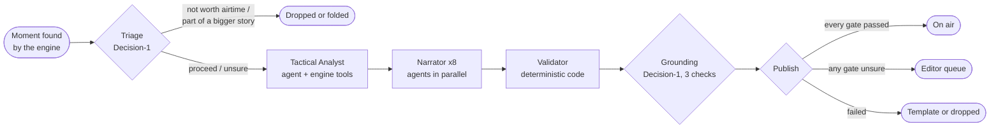
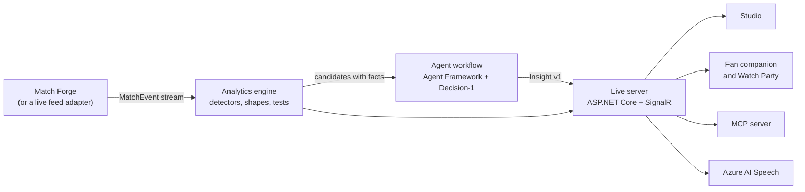

# Second Ball IQ: project overview

Second Ball IQ watches a football match as it happens and explains it to every kind of viewer, with evidence, in
seconds. It spots the moments that matter (a press that starts to bite, possession that goes nowhere, a coach
switching to a back three), has a team of agents explain them in the viewer's own language and depth, and checks
every word and number before anything reaches a screen. Then it does something commentary rarely does: it puts its
own reads to a test that the match itself settles, in public.

Built for the Microsoft x Premier League "Inside the Game" hackathon. All data is synthetic: fictional clubs,
players, matches and seasons generated by our own Match Forge.

This page is the short version. The full detail is in [ARCHITECTURE.md](ARCHITECTURE.md).

---

## The problem

Live football is full of meaning that most viewers miss. Why did the game turn after the break? Is that possession
actually hurting anyone? Why does the striker keep dropping deep? Broadcasters have the data to answer, but not the
people to explain every moment to every viewer, and a generative model on its own cannot be trusted on air: one
invented number or a goal described the wrong way, and the credibility is gone.

Second Ball IQ is built around one rule: **the engine measures, the models only explain.** Every figure a viewer
sees was computed by deterministic code from the match events. The language models choose words and which measured
facts to show; they never supply a number.

## What it brings

| For | Value |
| --- | --- |
| **Fans** | The match explained as it happens, at their level (beginner, casual, tactics fan, commentator), in English or Finnish, around their club or player. Ask anything and get a checked, evidence-backed answer. Watch together with friends: vote on whether a read will hold, pick set pieces against the AI, chat, raise tifos. |
| **Broadcasters and editors** | Lower-third graphics with a timing contract, written for several audiences at once, with the evidence attached. Anything a check is unsure about waits for a person; an editor can never put an unmeasured number on air either. |
| **Leagues, clubs and platforms** | A fan companion that keeps people in the match (polls, predictions, watch parties), and a public track record that turns AI commentary from "trust us" into "check us". |
| **Other systems and agents** | The same read-only queries our agents use, as an MCP server: any agent can ask the live match questions and get measured numbers with event ids to verify. |

## Key features

- **Seven detectors** on the live event stream: pressing shift, possession illusion, turnover to chance, goal,
  player milestone, tactical shift and player role. Each moment carries measured facts and the event ids it rests on.
- **Tactical intelligence**: each team's shape and formation read from where players touch the ball, roles such as
  false nine, shadow striker or wing-back, and changes of plan linked to their cause (a substitution, a goal,
  half-time).
- **A multi-agent workflow per moment** (Microsoft Agent Framework): triage, a Tactical Analyst agent with engine
  tools, eight Narrator agents in parallel (four audiences, two languages), a code Validator, a grounding check and
  a publish decision.
- **Tactical tests**: when a read goes to air, a measurable criterion and a deadline are locked with Decision-1's
  estimate, and the match events settle it as met, not met or inconclusive. The settled tests are a public record.
- **Decision-1 coach's corner**: every fifteen minutes (or when the studio or a fan asks), two coach agents with
  opposite instincts (front foot, game manager) each propose a plan for a team from a menu of measurable plans: press
  higher, sit deeper, go direct, keep the ball, take the final third. Decision-1 picks between them as a choice
  question with a probability for each; both plans are locked as tactical tests and the match settles them, so the
  record shows how often Decision-1 picked the plan that held. A what-if sandbox moves a team on the tracking frame
  now (push up, drop deep, widen, narrow, press the ball), shows pitch control before and after, and asks the same
  arbiter whether the change would help.
- **Ask Second Ball IQ**: a Match Analyst agent answers fans' questions with thirteen read-only tools over the match
  frozen at that second, shows its evidence on the pitch, and is checked before the answer appears.
- **Pass quality and ball speed**: every pass gets its length and a 0 to 100 difficulty rating from the engine's
  own rule, every pass and shot its speed in km/h. A shot from 110 km/h or a completed pass from 40 m tags the
  player by name on the pitch and gets a call from the commentator; an Analysis tab shows completion by difficulty,
  the hardest passes completed and the fastest shots.
- **Tracking, running and auto-eventing**: Match Forge also generates every player's and the ball's position ten
  times a second. From those positions alone the engine measures each player's distance, sprints and top speed (and
  tags a player on the pitch above 33.5 km/h), and an auto-eventer finds passes, shots and ball wins with their length,
  speed and result, scored live against the event feed: 96% of passes found with ball speed within 2.6 km/h.
- **Spatial analytics on tracking**: expected threat fitted on our own simulated matches, pitch control (who would
  reach each spot first), pass difficulty with the defenders in the passing lane (still checked against how often
  passes are completed), and "better pass available": the teammate whose pass would have delivered more threat. Two
  new detectors on top (Territory, Better pass) feed the same agents, gates and tactical tests.
- **A 3D match stage** (React Three Fiber) on wide screens: a procedural night stadium (crowd in club colours,
  floodlight beams, LED boards, two big screens, camera flashes, nets that ripple), 22 articulated players from
  tracking (gait, sprint lean, kicks, tackles, keeper stance and dives), four cameras (Auto with goal cuts, Broadcast,
  Tactical, Drone), a 15-second DVR with a telestrator drawn from tracking (offside line, team shapes, runs, pitch
  control, a locked player's live speed), and a clean feed. The 2D stage stays as the phone view and the fallback.
- **Broadcast overlay** (`/overlay`): the live graphics alone on a transparent or chroma-key page for a vision mixer,
  with SMPTE timecode and machine-readable render metadata.
- **Set-piece and next-goal predictions** from each taker's history, settled by what happens, with a public hit rate.
- **Watch Party**: a shared room with the stand of fans over the pitch, tactical-test polls, crowd picks, screened
  chat, reactions, tifos and a points table.
- **Live commentator and voices**: instant calls on goals and big chances (built from the event, never from a
  model), read aloud with Azure AI Speech neural voices.
- **Broadcast studio**: the live board, on-air preview, the agents' work step by step, editor queue and evaluation.
- **Proof**: ground truth for every generated match, fault drills that try to beat the checks, unit tests and an
  evaluation runner.

---

## How the agents check each other

No single model decides what goes on air. Each step has a different kind of judge, and each one can stop the next.

| Step | Who decides | What it checks | When unsure or failing |
| --- | --- | --- | --- |
| Triage | Decision-1 (choice) | Is this moment worth airtime, or part of a bigger story already running? | Low confidence goes to the editor; goals always proceed |
| Tactical Analyst | Agent (gpt-5.4-mini) with engine tools | Why it matters; picks fact keys and events, never values | Anything it cannot back up is removed; a template takes over |
| Narrators | Eight agents in parallel | Headline and summary per audience and language | Template draft |
| Validator | Deterministic code | Every cited event exists and belongs to the moment; every number in the text is a measured fact, the score, the window or a minute | The draft is replaced by a template built only from facts |
| Grounding | Decision-1 (three yes/no checks) | Do the events described appear in the evidence? Are outcomes (goal, save, miss) right? Would a neutral analyst agree? | Rejected drafts are replaced and re-checked; unsure goes to the editor |
| Publish | Code | Auto when every gate passed, editor when any was unsure, drop when a model draft failed | A template is never dropped, so a true moment cannot vanish on a model's doubt |
| Editor | A person | Publish, edit or reject, with the reason shown | An edit goes through the same Validator |
| The match | Code, after air | Tactical tests settle each read against later events | The result, the estimate and what the test cannot show are kept side by side |

Every model step has a deterministic fallback, so a failing or slow model never stops the match.

**Proof that the checks work.** Fault drills plant an error on purpose: an unmeasured number (the Validator's job)
or a claim the evidence does not support (grounding's job). Offline over 30 matches, the Validator caught 370 of 370
planted numbers and wrongly rejected none of 2,960 clean drafts. The studio can plant one live, and the agent trace
shows which check caught it.

---

## Microsoft-Decision-1: how and why we use it

Decision-1 answers typed questions about a described situation (a choice between options, or yes/no) with a
probability for each answer instead of free text. That is what a gate needs: a number to set thresholds on, an
honest "unsure" that can be sent to a person, and nothing to parse or second-guess. It is also fast: in our spike,
p50 about 200 ms and p95 about 335 ms after a cold first call.

We use it in ten places, always with a timeout and a safe fallback:

| Where | Question | What we do with the answer |
| --- | --- | --- |
| **Triage** | Which development in this window deserves airtime? (choice) | Proceed at 0.70 or more with a 0.20 margin; a confident "none" drops; anything else goes to the editor |
| **Grounding** | Three yes/no checks: events listed, outcomes match, a fair reading | Pass when every check is at least 0.40, drop when any is 0.15 or less, editor in between; 2.5 s timeout means editor, never a silent pass |
| **Ask Second Ball IQ** | Does the answer follow from what the tools returned? | Shown as "Checked by Decision-1"; a failed check gets one retry, then only measured facts are shown |
| **Set-piece predictions** | Near post, central, far post or short; the shooter's left, centre or right (choice) | The call on screen before the kick, settled by the kick, with a public hit rate |
| **Next goal** | Who scores in the next 10 minutes, if anyone (choice) | Same, settled after 10 minutes |
| **Tactical-test estimate** | Will this criterion be met by the deadline? (yes/no) | Shown beside the test, always labelled a model estimate, not a calibrated probability; asked from the match as it stood at the lock, so it cannot see later events |
| **Coach's corner** | Two coach agents propose different plans for a team; which will hold for the next ten minutes? (choice, one option per coach, each described by the criterion that settles it) | The pick and a probability for each plan; both plans become tactical tests, and the record counts how often the pick was the plan that held |
| **What-if sandbox** | Would this change of shape help the team over the next ten minutes? (yes/no, with the pitch-control change measured on the frame now) | Shown beside the before and after control maps, labelled a model estimate |
| **Watch Party questions** | Is this a respectful question about the match? | Screens room questions before they go to the Match Analyst |
| **Watch Party chat** | Is this message respectful? | Screens chat after a word list; 3 s timeout, so chat never stalls |

**What the spike taught us** (see [decision-1-spike.md](decision-1-spike.md)): triage was right 18 of 18 times when
the window was written as prose, but only 15 of 18 as raw numbers, so the engine writes every gate's input as plain
language. Grounding only worked once the evidence stated the derived facts (which regain led to which shot, what did
not happen) rather than raw events: then no true claim was blocked and no false claim passed. A check on counts was
removed after the first live run, because exact numbers are the deterministic Validator's job. Decision-1 reads
meaning; code reads numbers.

---

## Microsoft technology used

| Technology | Role |
| --- | --- |
| **Microsoft Foundry** | Hosts the models; one resource for chat, Decision-1 and Speech |
| **Microsoft-Decision-1** | The gates, the predictions, the tactical-test estimates and the Watch Party screening (above) |
| **gpt-5.4-mini** on Foundry | Tactical Analyst, Narrators, Recap Writer and Match Analyst, with structured JSON output |
| **Microsoft Agent Framework** | `ChatClientAgent` agents with function tools; the per-moment workflow as executors with conditional edges (`WorkflowBuilder`) |
| **Azure AI Speech** | Neural voices in English and Finnish, with SSML speaking styles for the commentator |
| **Model Context Protocol C# SDK** | The MCP server at `/mcp`: 17 tools over the live match |
| **ASP.NET Core and SignalR** (.NET 8) | The live server and real-time push to every screen |
| **Fluent UI React v9** | The studio and the fan companion |
| **Azure Container Apps and Container Registry** | Hosting, built and deployed by `infra/deploy.ps1` |

---

## Synthetic data: how Match Forge makes it

The hackathon rules call for synthetic data, and synthetic data gives us something real data cannot: **known ground
truth**, so we can measure whether the detectors find what is there and nothing else.

- **A possession-chain simulator** generates a match as an ordered stream of events: passes whose completion
  depends on accuracy, zone, pressure and length; pressure, tackles and interceptions; shots with expected goals;
  fouls, set pieces and substitutions.
- **Clubs have shapes.** Each club has a formation of eleven role slots. The ball goes to whoever is nearest, so
  touches gather around each player's role, and the engine can read formations and roles back from the touches alone.
- **Scenarios script the story.** A scenario changes team styles for phases of the match and injects moments, so the
  demo's story always happens: Harbor City's sterile possession, Northvale's press after the break, a switch to a
  back three, a turnover goal. Coaches react to the score (a leading team drops deep, a trailing one goes direct).
- **Deterministic.** The same scenario and seed always give the same match, so every result can be reproduced.
- **Ground truth comes with every match**: what the scenario was built to contain, measured from the generated
  events, including every shape spell.
- **A season archive.** Rounds 1 to 24 before the match are generated with the same takers' habits, so a free-kick
  taker's history really says something about the next kick, and the predictions have something honest to learn from.

The detectors use deliberately different rules from the generator's ground truth, so the two implementations check
each other. `forge evaluate` replays many seeds of every scenario and scores recall and false alarms.

- **Tracking from the events.** `TrackingSynth` turns a match into 22 players and a ball at 10 Hz in metres: each
  player holds a formation slot, shifts with the ball and possession, reaches each of their touches on time and is
  held to a personal top speed; passes and shots fly at the speed the event gives, with 12 cm of measurement noise
  on top. `forge autoevent` then runs the auto-eventer on the positions alone and scores it against the events.

---

## Connecting to real data and platforms

Everything downstream of the event stream is source-agnostic. The connection point already exists in the code: a
match is a `MatchInfo` plus an ordered stream of `MatchEvent` records (`src/MatchLens.Contracts`), and the live
server feeds each event to the engine with `LiveMatch.Ingest`. Match Forge is simply one source of that stream.

**What a real feed needs (not built; nothing downstream changes):**

1. **An adapter** from a licensed live event feed to `MatchEvent`: map the provider's event types to ours (pass, shot,
   goal, pressure, tackle, interception, possession change, foul, card, substitution), convert coordinates to our
   0 to 100 frame in the acting team's direction, and keep the match clock monotonic.
2. **Team sheets and history**: line-ups and shirt numbers into `MatchInfo`; the season archive from the provider's
   historical data, so set-piece predictions and player cards use real records.
3. **Ingestion at scale**: the feed into Azure Event Hubs, one consumer per match, each running its own match session.
4. **Persistence**: today state is in memory, one match at a time. Insights, tests and the record would go to Cosmos
   DB, and the event history to Microsoft Fabric for analysis across a season.
5. **Auto-eventing from video (half built)**: the brief suggests running a model over the video feed to produce the
   pass and speed numbers instead of tagging them by hand. The second half of that exists: the auto-eventer turns
   positions (`TrackingFrame`: every player and the ball, in metres, ten times a second) into passes, shots, ball
   wins and their speeds, and the running numbers come from the same frames. The first half, a vision model (for
   example a custom detection model on Azure AI Vision) that finds players and the ball in each video frame, is not
   built: there is no synthetic match video to run it on. Its output would feed `TrackingFrame` in place of
   `TrackingSynth`, and nothing downstream changes.
6. **A real tracking feed**: a provider's optical tracking maps straight onto `TrackingFrame`. Shape and roles come
   from touch positions today; read from tracking they would also see off-the-ball runs and defensive lines.

**Evaluation with real data.** Without generated ground truth, three things carry the proof: the tactical tests
(the match settles every read on air, in public), the editor queue, and offline evaluation on historical matches
labelled by analysts, using the same `forge evaluate` scoring.

**Where it plugs into a platform:**

- **Broadcast graphics**: Insight v1 records (headline, summary, figures, evidence, display time) are a stable JSON
  contract for a graphics system, pushed live over SignalR.
- **A league or club app**: the fan companion is a web app that can be embedded, or its feed consumed as an API.
- **Partner agents**: the MCP server lets any agent (an IDE assistant, a Foundry agent, another broadcaster's
  system) query the live match with the same read-only tools our agents use.

---

## At a glance

## Results so far

- **Live runs** with gpt-5.4-mini and Decision-1: each moment through the whole workflow in about 4 to 6 seconds;
  about two thirds of insights published automatically, the rest sent to the editor rather than dropped.
- **Fault drills**: 370 of 370 planted numbers caught, 0 of 2,960 clean drafts wrongly rejected.
- **Tactical tests** over 60 simulated matches: 134 opened, every one settled by the match in code. In the demo the
  possession read is broken by a goal, the pressing read is met at 59:53 and Northvale's 3-4-1-2 is confirmed at 72:01.
- **Auto-eventing from tracking** over 20 matches: passes 96.2% found and 98.4% real, receiver right 98.8%, length
  ±1.5 m, ball speed ±2.6 km/h; shots 78.4% found and 88.0% real, result right 99.6%, every goal found; ball wins
  95.8% found. Running distance within 1.7% of the noise-free truth.
- **Spatial analytics**, on 20 matches the fits never saw: hard passes by the lane rating are completed 41% of the
  time against 87% for easy ones (AUC for a failed pass 0.705, up from 0.680 without the lane); in the quarter of
  five-minute spells with the most final-third control teams take three times the shots of the quarter with the
  least; Territory and Better pass each fire about once a match.
- **47 unit tests** that call no model, and a CI workflow that builds and runs them on every push.

## Honest limits

Synthetic data only, by design. Decision-1's tactical-test estimates are not calibrated, and are labelled so
everywhere. State lives in memory, one match at a time. Shape and roles come from touches. The
tracking is synthesised from the events, so auto-eventing on it is a consistency test of the detector, not proof on
real video, and the lane and pitch-control checks run on positions placed to match the events (interceptors react
only just before a pass, which limits but does not remove that). Details and next steps are in [ARCHITECTURE.md](ARCHITECTURE.md#limitations-and-next-steps).

## Where to read more

| Document | What is in it |
| --- | --- |
| [ARCHITECTURE.md](ARCHITECTURE.md) | Every feature, the architecture and the data contracts in full |
| [agents.md](agents.md) | The agents, their prompts and the lessons from live runs |
| [analytics.md](analytics.md) | The engine and the detectors |
| [match-forge.md](match-forge.md) | The synthetic match generator |
| [decision-1-spike.md](decision-1-spike.md) | How Decision-1 was tested before it was trusted |
| [server.md](server.md) | Running the live server and the UI |
